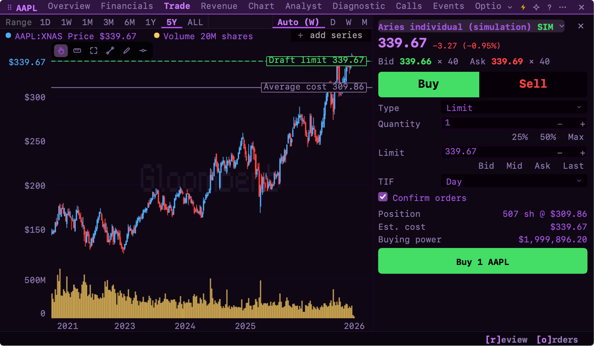

# Aries for Gloom

Trade your Aries account from Gloom: accounts, live quotes, charts, option chains and orders.

## Set up

1. Install [Gloom](https://gloom.sh) 0.18.2 or later.
2. Open **Plugins** (`PL`), find **Aries** and install it.
3. Open **Brokers** (`BR`), add **Aries** and press **Connect**. Sign in to Aries in the browser that opens.
4. Start on **Simulation**. Turn on **Enable trading** to place orders.

[TESTING.md](TESTING.md) walks through a first simulation order. A personal API client from Aries Client Center also works ([setup](docs/setup.md)).

## What works

- Simulation and live accounts, balances and positions
- Real-time quotes, charts and option chains
- Stock, ETF and option orders, and spreads of 2 to 4 legs
- Live order updates and 90 days of history

## Good to know

- Trading is off until you turn it on. A live order asks you to type its symbol.
- Your sign-in and Aries quotes stay on your machine. Accounts sync with Gloom Cloud unless you keep them local.
- Independent plugin, not affiliated with Aries.

## More

[Setup](docs/setup.md) · [Features](docs/features.md) · [Trading](docs/trading.md) · [Privacy and terms](docs/privacy.md) · [API notes](docs/aries-api-notes.md) · [Development](docs/development.md)
